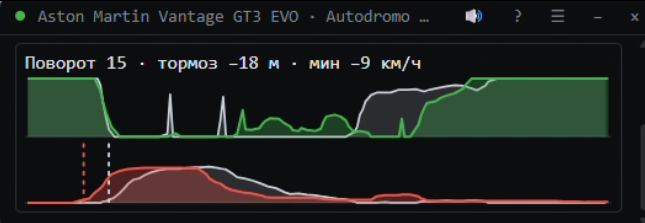

# AI Engineer

**Голосовой тренер по пилотажу для iRacing.** Маленькое окно поверх сима и голос в
наушниках, по-русски. Ставит одну цель на выезд, следит за ней каждый круг и в боксах
говорит, что вышло.

### [⬇ Скачать последнюю версию](https://github.com/Peretz30/ai-engineer-releases/releases/latest)

Windows 10/11, 64 бита · 188 МБ · без прав администратора · дальше обновляется сам

▶ [Демо со звуком, 73 секунды](demo.mp4): Aston Martin на Муджелло, цель — поворот 15.

---

## Что делает

- **Одна цель на выезд.** Несколько чистых кругов — и на выезде из боксов инженер
  называет, над чем работать: «поворот 5 — теряешь 0,4 с к эталону» или «стабильность:
  круги гуляют на 0,8 с».
- **Каждый круг — про эту цель.** На выходе из поворота-цели в окне график газа и
  тормоза поверх эталона, а голосом — ближе к цели, как было или дальше, и что
  отличалось: «тормозишь на 11 метров позже, на 19 км/ч медленнее в минимуме».
- **С кем сравнивает.** С реальным кругом другого пилота на твоей машине, чуть быстрее
  тебя. Догнал — берёт следующий. Где чужих кругов нет — с твоим же лучшим.
- **Разбор в боксах** и новая цель. Работает в практике.
- **Журнал**: цели, чем кончились, твои заметки.

## Где работает

| Машина | Трассы с эталонами |
|---|---|
| **GT3**, все 11 машин | Нордшляйфе, Mugello, Red Bull Ring, Imola, Daytona, Fuji, Indianapolis, Long Beach, VIR, Adelaide, Le Mans, Tsukuba |
| **Mazda MX-5 Cup** | Lime Rock GP, Mount Panorama, Charlotte Roval, Oulton Park, Navarra, Нюрбургринг GP |
| **Porsche 911 Cup** | Mount Panorama, Road America, COTA GP |

На других трассах инженер сравнивает с твоим лучшим кругом.

## Установка

1. [Скачай](https://github.com/Peretz30/ai-engineer-releases/releases/latest)
   `AiEngineer-Setup-….exe` и запусти.
2. Если Windows покажет «Система Windows защитила ваш компьютер» — **Подробнее** →
   **Выполнить в любом случае**. Установщик пока не подписан.
3. Один раз включи запись телеметрии: закрой iRacing, в `Документы\iRacing\app.ini` в
   разделе `[Misc]` поставь `irsdkEnableDisk=1` и `irsdkAutoLogDisk=1`.
4. Чтобы окно было видно поверх сима на том же мониторе: в iRacing **Options →
   Graphics**, сними **Full Screen** и **Border**.

Открой **AI Engineer** из «Пуска», сядь в машину и выезжай — дальше инженер ведёт сам.
Новые версии окно предложит при запуске, одной кнопкой.

## Чего не делает

Не советует по сетапу. В интернет ходит только при запуске — спросить, нет ли новой
версии.
